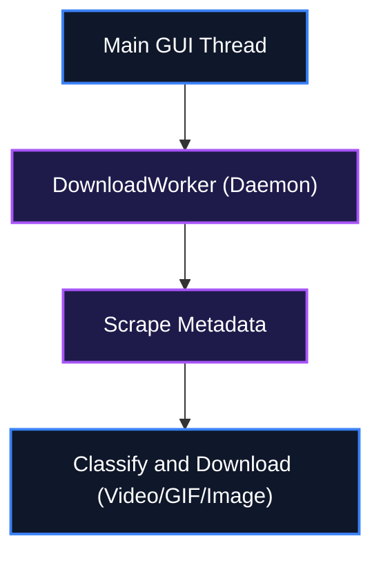

<!--
  MASTER README TEMPLATE
  Copy this file into any new or existing repository as README.md and fill in every
  [BRACKETED] field. Delete any optional section (Mathematical Foundations, Screenshots)
  that does not apply to the project. Keep section ordering consistent across repos —
  this is what makes a portfolio look like one coherent body of work instead of
  twenty unrelated dumps.
-->

# 📌 Pinterest Mass Downloader — A fast desktop application for bulk downloading Pinterest media

[](LICENSE)
[](#)
[](#)
[](#)

A fast, threaded desktop application for bulk downloading Pinterest images, videos, and GIFs by keyword search or board URL, featuring a premium dark-themed GUI.

---

## 📖 Table of Contents
- [Key Features](#-key-features)
- [System Architecture](#%EF%B8%8F-system-architecture)
- [Quick Setup & Installation](#-quick-setup--installation)
- [How to Use](#-how-to-use)
- [File Structure](#-file-structure)
- [License](#-license)

---

## ✨ Key Features

- Keyword Search & Board URL Modes: Search any topic or paste a board/pin URL to bulk download.
- Accurate Media Filtering: Two-step scrape and classify pipeline ensures only selected media types are downloaded.
- Independent Per-Type Sliders: Separate count controls for Pictures, Videos, and GIFs.
- Download Queue & Parent Folder Mode: Queue multiple searches and automatically organize into subfolders.
- Threaded Downloads: Adjustable parallel thread slider for 1-32 concurrent connections.

---

## ⚙️ System Architecture

Data flow from the GUI thread to the daemon download worker, classifying and saving different media types.



---

## 🚀 Quick Setup & Installation

### Prerequisites (Zero-Dependency Setup)
This guide assumes a clean machine with **no pre-installed tools**.

```cmd
winget install --id Python.Python.3.10 -e --accept-source-agreements --accept-package-agreements
winget install --id Git.Git -e --accept-source-agreements --accept-package-agreements
```

🔍 **Verification Command**:
```cmd
python --version
```
*Expected Output*: `Python 3.10.x`

### Clone & Install
```bash
git clone https://github.com/IamOumarIbrahim/pinterest-mass-downloader.git
cd pinterest-mass-downloader
pip install -r requirements.txt
```

### Run
```bash
python pinterest_downloader.py
```

---

## 🛠️ How to Use

1. Launch the application using `python pinterest_downloader.py` or the Windows installer executable.
2. Select Keyword Search or Board / Pin URL mode.
3. Drag the media sliders (Pictures, Videos, GIFs) to set download counts and choose an output folder, then click START DOWNLOAD.

```bash
# Example command
python pinterest_downloader.py
```

---

## 📁 File Structure

pinterest-mass-downloader/
├── pinterest_downloader.py - Main GUI entry file
├── requirements.txt
└── README.md

---

## 📄 License
This repository is licensed under the [MIT License](LICENSE).
