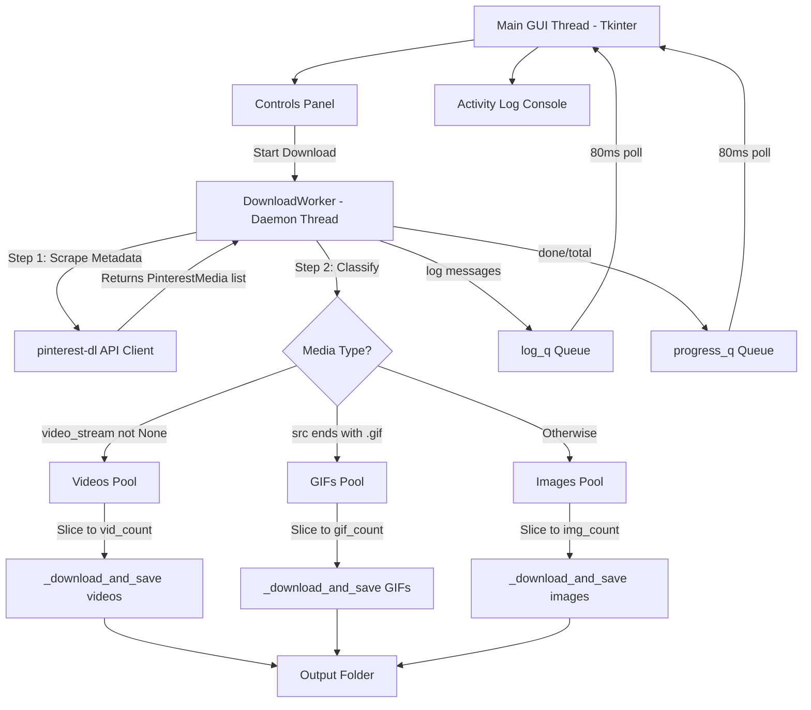

# 📌 Pinterest Mass Downloader

[](https://www.python.org/)
[](https://docs.python.org/3/library/tkinter.html)
[](https://www.microsoft.com/)
[](https://github.com/sean1832/pinterest-dl)
[](LICENSE)

A fast, threaded desktop application for bulk downloading Pinterest **images**, **videos**, and **GIFs** by keyword search or board URL. Featuring a premium dark-themed GUI with independent per-type count controls, live activity logging, and a two-step classify-before-download pipeline that guarantees only the media types you actually selected are saved to disk.

> **Personal productivity tool** — built for designers, artists, and collectors who need fast bulk Pinterest downloads without browser extensions or subscription tools.

---

## 📖 Table of Contents
- [Download](#-download)
- [Key Features](#-key-features)
- [System Architecture](#%EF%B8%8F-system-architecture)
- [Quick Setup & Installation](#-quick-setup--installation)
- [How to Use](#-how-to-use)
  - [Keyword Search Mode](#keyword-search-mode)
  - [Board / Pin URL Mode](#board--pin-url-mode)
- [Media Type Filtering Pipeline](#-media-type-filtering-pipeline)
- [Dependencies](#-dependencies)

---

## 📥 Download

> **One-click Windows installer — no Python required.**

[](https://github.com/IamOumarIbrahim/pinterest-mass-downloader/releases/latest/download/PinterestMassDownloader_Setup.exe)

Download the latest `PinterestMassDownloader_Setup.exe` from the link above, run the [Inno Setup](https://jrsoftware.org/isinfo.php) installer, and launch directly — no Python or pip setup needed.

For manual / developer installation, see [Quick Setup & Installation](#-quick-setup--installation) below.

---

## ✨ Key Features

- 🔍 **Keyword Search** — search any topic (e.g. `Fortnite cosplays`, `cyberpunk art`)
- 🌐 **Board / Pin URL** — paste any Pinterest board or pin URL to bulk download its content
- 📋 **Download Queue** — queue multiple searches/URLs and download them sequentially without manual intervention
- 📁 **Parent Folder Mode** — automatically generates query-named subfolders inside a selected parent directory
- 🖼️ **Independent Per-Type Sliders** — separate count controls for **Pictures**, **Videos**, and **GIFs** (0–300 each)
- ✅ **Accurate Media Filtering** — uses a two-step scrape → classify → download pipeline; selecting "Videos" will **never** save JPGs
- ⚡ **Threaded Downloads** — adjustable parallel thread slider (1–32 concurrent connections)
- 📋 **Live Activity Log** — color-coded real-time console (green = success, yellow = warning, red = error)
- ⏹️ **Stop Button** — gracefully cancel a download mid-session without crashing
- 🎨 **Premium Dark Theme** — Pinterest red accent, Segoe UI typography, animated progress bar

---

## ⚙️ System Architecture

The GUI thread is fully isolated from all download work using a thread-safe queue messaging architecture. Long-running scrapes and downloads never freeze the interface.

> [!NOTE]
> **Two-Step Download Pipeline**: The app first scrapes Pinterest metadata (no files downloaded yet), classifies every pin by type using `PinterestMedia.video_stream` and URL extension detection, slices to the exact counts you requested, then downloads each type separately. This prevents wrong file types from ever reaching your output folder.



---

## 🛠️ Quick Setup & Installation

**Option A — Windows Installer (Recommended)**

Download and run the installer:

➡️ [`PinterestMassDownloader_Setup.exe`](https://github.com/IamOumarIbrahim/pinterest-mass-downloader/releases/latest/download/PinterestMassDownloader_Setup.exe)

**Option B — From Source (Developer)**

Requires Python 3.10+.

```bash
git clone https://github.com/IamOumarIbrahim/pinterest-mass-downloader.git
cd pinterest-mass-downloader
pip install -r requirements.txt
python pinterest_downloader.py
```

On first launch, if `pinterest-dl` is not installed, the app will detect this and offer to install it automatically.

---

## 📘 How to Use

### Keyword Search Mode
1. Select **Keyword Search** in the Input Type section
2. Type your query in the text box — e.g. `Fortnite cosplays`
3. Drag the **Pictures**, **Videos**, and/or **GIFs** sliders to your desired counts
4. Click **Browse…** to choose your output folder
5. Adjust the **Parallel Threads** slider for download speed (default: 8)
6. Click **▶ START DOWNLOAD**

### Board / Pin URL Mode
1. Select **Board / Pin URL** mode — or simply paste a Pinterest URL; the app auto-detects it
2. Paste the URL (e.g. `https://www.pinterest.com/username/board-name/`)
3. Set your per-type counts and output folder
4. Click **▶ START DOWNLOAD**

### 📋 Using the Download Queue
1. Click **Parent Folder** to choose a root directory where all downloads will go.
2. Enter a keyword or URL in the query box.
3. Drag the **Pictures**, **Videos**, and/or **GIFs** sliders to your desired counts.
4. Click **+ Queue** (or press `Enter` in the query field) to add the search to the list.
5. Repeat for any other searches you wish to queue up.
6. Review the list in the **Download Queue** panel. You can select items and click **Remove Selected** or **Clear Queue** to manage the list.
7. Click **▶ START QUEUE (N)** to begin downloading all queries sequentially without manual intervention.

> [!TIP]
> Subfolders named after each search query will be created inside the chosen Parent Folder. If you don't choose a parent folder but use the queue, subfolders will be created inside the default save folder.

> [!TIP]
> Set sliders you don't need to **0** to skip that media type entirely and download faster. For example, set Videos and GIFs to 0 for an images-only run.

> [!WARNING]
> Pinterest may rate-limit heavy requests. If you're downloading 300+ items, consider reducing the thread count to 4–6 to avoid temporary blocks.

---

## 🔬 Media Type Filtering Pipeline

Unlike naive approaches that download everything then hope for the best, this app uses a precise pipeline:

| Step | What happens |
|------|-------------|
| **1. Scrape** | Fetch `4×` the total requested count as a metadata buffer — no files downloaded yet |
| **2. Classify** | Each `PinterestMedia` object is inspected: `video_stream` set → **Video**; `.gif` URL → **GIF**; otherwise → **Image** |
| **3. Slice** | Take only the exact count you requested per type; log a warning if fewer were found |
| **4. Download** | Call `_download_and_save()` separately per type with the correct stream flag |

This means selecting **Videos only** will **never** produce `.jpg` or `.png` files in your output folder.

---

## 📦 Dependencies

| Package | Version | Purpose |
|---------|---------|---------|
| `pinterest-dl` | ≥ 1.3.0 | Core Pinterest scraping & downloading |
| `tkinter` | built-in | Desktop GUI framework |
| `requests` | transitive | HTTP client |
| `m3u8` | transitive | Video stream parsing |

---

## 🙏 Powered By

- [pinterest-dl](https://github.com/sean1832/pinterest-dl) by [@sean1832](https://github.com/sean1832) — API-first Pinterest media downloader

---

## ⚠️ Disclaimer

This tool is for **personal and educational use only**. Automated scraping may conflict with Pinterest's [Terms of Service](https://developers.pinterest.com/terms/). Use responsibly and at your own risk. The author is not affiliated with Pinterest.

---

## 📄 License

MIT © 2026 [Oumar Ibrahim](https://github.com/IamOumarIbrahim)
