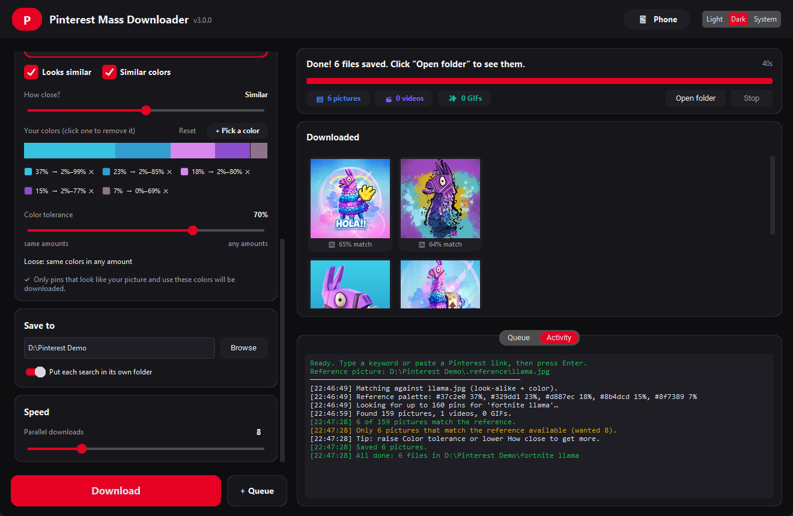
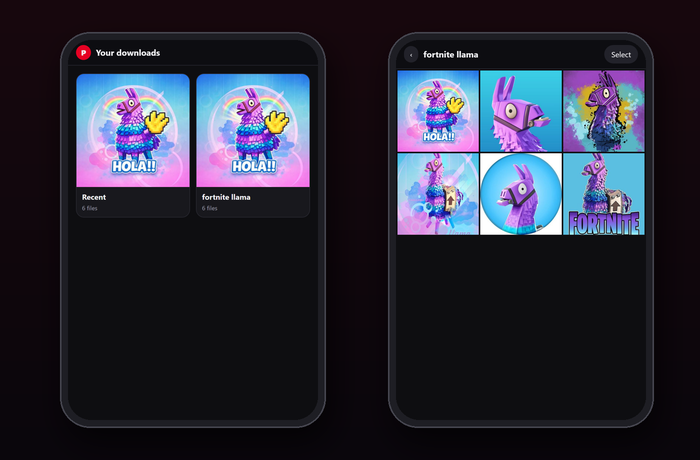

<div align="center">
  <h1>Pinterest Mass Downloader</h1>
  <p><strong>Bulk-download Pinterest pictures, videos and GIFs, keep only the ones that look like the picture you love, and use them from your phone.</strong></p>

  <p>
    <a href="https://www.python.org/"></a>
    <a href="LICENSE"></a>
    
  </p>
</div>

<p align="center">
  <a href="https://github.com/IamOumarIbrahim/pinterest-mass-downloader-gui/releases/latest/download/pinterest_downloader.exe"></a>
</p>

<p align="center">
  <a href="assets/demo.mp4"></a>
  <br />
  <sub>One-minute walkthrough. <a href="assets/demo.mp4">Watch it in full quality (MP4)</a>.</sub>
</p>

## Quickstart

```bash
git clone https://github.com/IamOumarIbrahim/pinterest-mass-downloader-gui.git
cd pinterest-mass-downloader-gui
pip install -r requirements.txt
python pinterest_downloader.py
```

Type something, press **Enter**. That's it. Everything else is optional and the app remembers your choices.

No Python on the PC you want it on? `python tools/build_exe.py --zip` builds a Windows folder you can copy anywhere and run.

## How it works

| | Step | What you do |
|:-:|:--|:--|
| **1** | **Search** | Type a keyword (`fortnite llama`) or paste a board / pin link. Recent searches are one click away. |
| **2** | **How many** | Drag the Pictures, Videos and GIFs sliders. Set a slider to 0 to skip that type. |
| **3** | **Match a picture** *(optional)* | Drop a picture on the window, click to browse, or press **Ctrl+V**. Tick **Looks similar**, **Similar colors**, or both. |
| **4** | **Download** | Matches stream into the gallery with their match score. Click a tile to open it. |
| **5** | **Phone** *(optional)* | Scan the QR code and browse or share everything from bed. |

Use **+ Queue** to line up several searches and run them in one go. Each search gets its own folder.

Downloads start while the search is still running: the first files land within a few seconds, and searching stops as soon as you have what you asked for.

## More ways to get exactly what you want

| | What it does |
|:--|:--|
| **More like this** | Every downloaded tile has this button. It searches for what that picture shows and keeps the ones that look like it, next to the original. |
| **Describe it** | Type `line drawing, no words` under *Match a picture* and only pins that fit are kept. Commas separate ideas; start one with `no` to rule it out. Works with or without a reference picture. |
| **Let me pick first** | Shows small previews instead of downloading. Click the ones you want, then **Download picked**. **More like my picks** fetches another round, steered by what you picked and what you passed over. |
| **Shape and size** | Tall (phone wallpaper), wide (desktop) or square, and a minimum size. Pinterest reports both with the search results, so nothing unsuitable is ever downloaded. |
| **Follow** | *Following* tab → **Follow this search**. From then on the app fetches only what's new, when it opens or when you press **Check**. Works for searches, boards and profiles. Something you deleted on purpose doesn't come back. |
| **Search your downloads** | The box above the gallery finds old downloads by the words of the search, the title and Pinterest's own description, and, with smart matching, by what the picture shows (`sunset over water`). |

**Links that work:** boards, board sections, whole profiles, search pages, idea pages, single pins and `pin.it` short links.

**Private boards** need your Pinterest login. Under *Pinterest login*, choose a cookies file exported from your browser while signed in to pinterest.com (a "cookies.txt" extension does this). The file's contents stay on your PC.

## Match a picture

<p align="center"></p>

Pick a reference picture and the app checks every candidate against it before downloading. Only the winners are saved.

**Looks similar** uses **smart matching**: a small AI model (CLIP) that understands what a picture shows, so a 3D render and a sticker of the same character count as similar. The model is about 150 MB and downloads once, the first time you use it; it runs on your PC and nothing is uploaded. **How close?** sets how picky it is, from *Loosely related* (same subject) to *Nearly identical* (the same picture).

Turn **Smart matching** off to use the classic matcher instead, which compares composition, shapes and edges and needs no download. With it, *How close?* keeps the best share of what the search finds: ~60% at the loose end, ~8% at the strict end.

**Similar colors** turns the picture into a palette (the color bar) and checks that each download is made of those colors. **Color tolerance** decides how much the *amounts* may differ:

| Tolerance | Meaning | A grey / black / red reference matches... |
|:--|:--|:--|
| **0–15** Strict | same colors in almost the same amounts | mostly grey, some black, a little red |
| **15–40** Close | amounts may shift a little | a bit more black, a bit less grey |
| **40–70** Relaxed | amounts can change a lot | half red, half grey |
| **70–100** Loose | same colors in any amount | any mix of grey, black and red |

Each swatch shows its allowed range live, for example `37% → 2%–73%`. Two sensible limits always apply. Every main color must appear at least a little. And at the strict end, colors that aren't in the palette (a different background, say) can only take up a small share.

**Pick your own colors.** Click **+ Pick a color** to add any color, or click a swatch to remove it. This works without a reference picture too: pick red and black and you'll only get red-and-black pins.

> [!TIP]
> Nothing matched? The keyword picks the subject and the picture narrows it down, so be specific (`fortnite llama`, not `fortnite`). You can also raise the tolerance or lower **How close?**.

## Use your downloads on your phone

<p align="center"></p>

Leave the PC on and go lie down. Click **Phone** in the app, scan the QR code with your phone's camera, and your download folder opens as a gallery in the phone's browser. Nothing is copied to the phone: pictures are streamed from your D: drive (or whichever folder you pick) only when you look at them.

- **Share to Instagram, WhatsApp, TikTok...** Tap a picture, tap **Share**, pick the app. Or use **Select** to share several at once, for example as a carousel.
- **Search and download from bed.** Type a search on the phone and tap **Download to PC**: the PC fetches it and the new album appears on the phone, with a progress bar while it works. **Find in my downloads** searches what you already have.
- **Albums** match your folders, with the newest downloads first. Swipe left and right in the viewer. Videos play inline.
- **Add it to your home screen** (browser menu → *Add to Home screen*) so it opens like an app.
- Tick **Turn on automatically when the app opens** so the gallery is always available.

> [!NOTE]
> **Why "Share" and not Instagram's own attach button?** Instagram's picker only shows the phone's photo library, so no app can put a PC folder in there without saving the files on the phone. Going the other way works: open the gallery, tap **Share**, choose Instagram. The picture goes straight into your post, story or DM and never lands in your camera roll.

**One-tap Share buttons** need a secure (HTTPS) page. On plain Wi-Fi links you can always **long-press** a picture to share or copy it. For the buttons, tap *switch to secure mode* in the gallery and accept the one-time "certificate is self-made" warning (*Advanced → Proceed*).

**Privacy:** the gallery only works on your home network and only with the secret key built into the QR code. Other devices on the Wi-Fi get a locked page. The first time, Windows may ask about the firewall: allow **Private networks**.

You can also start it without the app:

```bash
python pinterest_downloader.py --phone "D:\Pinterest"
```

## Command line

Every app feature is also available from a terminal:

```bash
python pinterest_downloader.py --keyword "fortnite llama" --limit 30 --out "D:\Pinterest"
python pinterest_downloader.py --board "https://pinterest.com/user/board" --videos 10 --gifs 10
python pinterest_downloader.py -k "fortnite llama" -r llama.jpg --similar --colors --tolerance 60
```

| Flag | Description | Default |
| :--- | :--- | :--- |
| `--keyword`, `-k` | Search term | |
| `--board`, `-b` | Any Pinterest link: board, section, profile, search, pin (`pin.it` works) | |
| `--phone FOLDER` | Share a folder with your phone (prints a QR code) | |
| `--limit`, `-n` | Number of pictures | 50 |
| `--videos` / `--gifs` | Number of videos / GIFs | 0 |
| `--out`, `-o` | Output folder | `./downloads` |
| `--threads` | Parallel downloads (1-32) | 8 |
| `--reference`, `-r` | Reference picture | |
| `--similar` / `--colors` | Match its look / its colors | look, if `-r` is given |
| `--tolerance` | Color tolerance, 0 (same amounts) to 100 (any amounts) | 50 |
| `--closeness` | Look-alike strictness, 0 to 100 | 50 |
| `--describe`, `-d` | Keep pins that fit a description, e.g. `"line drawing, no words"` | |
| `--classic` | Don't use the smart model; compare shapes and edges only | |
| `--min-size` | Shortest side of the original, in pixels | any |
| `--shape` | `tall`, `wide` or `square` | `any` |
| `--follow` | With `-k`/`-b`: remember it and fetch only what's new next time | |
| `--check-follows` | Fetch what's new for everything you follow | |
| `--follows` / `--unfollow NAME` | List what you follow / stop following | |
| `--allow-duplicates` | Download even what the library says you already have | |
| `--cookies FILE` / `--sign-out` | Sign in with exported browser cookies / forget them | |

## Good to know

- **You only get what you asked for.** Every file is checked after downloading: pictures are real still images, GIFs are animated, and videos are real videos. A pin that turns out to be the wrong type is deleted and replaced with the next candidate.
- **No duplicates, in any folder.** The app keeps a small library of what it has downloaded. A picture you already have is skipped even if it was saved by another search into another folder, and so are re-pins and re-uploads of the same picture at another size. Running the same search again therefore brings *new* pictures. Switch this off with *Skip pictures I already have*. Interrupted downloads never leave half-written files behind.
- **Videos need ffmpeg.** Pinterest serves videos as streams. `imageio-ffmpeg` (in `requirements.txt`) brings ffmpeg along; nothing else to install.
- **Updates.** Once a day the app asks GitHub whether a newer release exists and shows a button if so. Nothing is installed automatically. Set `"check_updates": false` in `settings.json` to stop it asking.
- **Settings** (folder, sliders, reference, phone key), the library and the smart model are stored in `%APPDATA%\PinterestMassDownloader`.

<details>
<summary><b>Project layout</b></summary>

```
pinterest_downloader.py   entry point (app, or CLI when given arguments)
pinmass/
  gui.py                  desktop app (customtkinter)
  worker.py               the pipeline: search, match and download all at once
  scraper.py              Pinterest searches, boards, sections, profiles; sign-in
  media.py                downloads + file-type verification
  matching.py             look-alike, description and color matching
  smart.py                the CLIP model behind smart matching (onnxruntime)
  library.py              what you've downloaded: duplicates, search, follows (SQLite)
  phone.py, phone_page.html   phone gallery server and web app
  remote.py               starting downloads from the phone without the window
  net.py, update.py       broken-IPv6 workaround, new-version check
  cli.py, settings.py
tests/unit/               pytest suite
tools/build_exe.py        builds the no-Python Windows app (PyInstaller)
tools/demo/               scripts that record and edit the demo video above
```

Run the tests with `python -m pytest tests`. To re-record the demo, run `python tools/demo/record_demo.py <reference.jpg> <workdir>` and then `python tools/demo/compose_video.py <workdir> assets/demo.mp4 assets/demo.gif`.
</details>

## Help the project

Did this help you? Please give it a **star**, so more people can find it. Bugs and ideas are welcome in [Issues](https://github.com/IamOumarIbrahim/pinterest-mass-downloader-gui/issues).

## License

MIT License.
